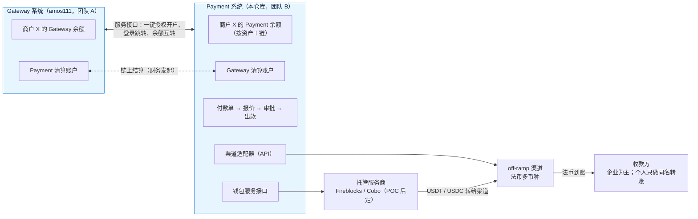

# 《系统架构方案》v1：Payment（代付）系统
- 版本：v1.3
- 产出角色：PM（业务视角）、研发（技术视角）、运维（托管和基础设施），整合 Amos 和智能体 2026-10-23 的方案讨论
- 状态：✅ **方案已由 Amos 确认**（2026-10-23："方案确认"）。下一步：流程图（`技术方案/v1-流程图.md`，4 个问题已答复）→ 原型 → Amos 和团队确认 → 才开始开发
- 依据 agents main `bd492c9`
- 变更历史：v1（2026-10-23）首次创建；v1.1（2026-10-23）按 Amos 对流程图 4 个问题的答复修改：直接付 USDT / USDC 不经交易员选渠道、渠道失败换渠道重试、清算由工作人员发起、商户审批金额由商户自己定；不做市场调研和风格方向；v1.2（2026-10-25）商户管理员可以审批自己提交的付款单；v1.3（2026-10-26）新增提币（§5.1）

## 一图看懂

## 1. 业务（PM）
| 业务 | 说明 |
|---|---|
| Gateway | 帮商户**收**客户的钱（已有系统 `dollar3651314/amos111`） |
| Payment | 帮商户**付**钱给合作伙伴、渠道和其他需要付款的对象。商户把大量 USDT（或 USDC）充值进系统，平台通过对接的 off-ramp 渠道付出法币，或者直接付 USDT、USDC |
| 交叉销售 | 两套系统都可以向自己的商户推荐对方的业务，有需求的商户"一键授权开户"，之后由对方系统提供服务 |

- **两套系统、两个运营团队**：各自有商户、KYB、账本、钱包、后台；通过服务接口互相调用、互相提供服务。
- **收款方**：企业为主；个人收款只做大额同名转账（个人商户把自己的钱付到自己名下的银行账户，收款户名必须和 KYC 姓名一致）。
- **付款币种**：USDT、USDC、多种法币；USDT 和 USDC 可以互换。**第一版全部一起上线**，不拆开。
- **单笔规模**：几万到几百万 USDT。
- **范围外**：运营主体和牌照（Amos 的法务已经处理，不在本方案讨论）。

## 2. 已确认的决定
| # | 项目 | 决定 |
|---|---|---|
| 1 | 系统划分 | Gateway、Payment 两套系统、两个团队；服务接口互相调用 |
| 2 | 互相开户 | 一键授权开户：商户同意后复用对方的 KYB 资料，各自审核；开通后用登录跳转进入对方系统（§4） |
| 3 | 余额互转 | 实时记账，财务在后台发起链上结算（§5） |
| 4 | 余额口径 | 按"资产＋链"记（例如 TRON 上的 USDT 和以太坊上的 USDT 分开）；跨链费用单独计算 |
| 5 | 付款方式 | 付法币（经渠道）和直接付 USDT、USDC 都支持；法币多币种；第一版全部一起上线 |
| 6 | USDT ↔ USDC | 由现有服务商提供 |
| 7 | 渠道 | 通过 API 对接；每个渠道一个适配器；系统推荐渠道、工作人员确认 |
| 8 | 报价 | 锁定 15～30 分钟，超时重新报价；价格 ＝ 成本 ＋ 汇率加点 ＋ 手续费 |
| 9 | 托管 | Fireblocks、Cobo 两家都做 POC，按结果再定；系统里加一层钱包服务接口，服务商可以替换（§7） |
| 10 | 链 | 主流链都做，以托管服务商的支持为准 |
| 11 | 平台出款审批 | 第一版不按金额分档：所有付款单"一人提交 ＋ 另一人审批"；托管服务商的规则再把一道关（只能转白名单地址）（§8） |
| 12 | 商户内部审批 | 企业商户支持多用户，分提交人和审批人 |
| 13 | 提币（Amos 2026-10-26） | 商户可以把多余的钱提到自己的钱包；同时开通 Gateway 的商户还可以余额互转，只开通 Payment 的只能提币（§5.1） |

## 3. Payment 系统的模块（研发）
| 模块 | 内容 |
|---|---|
| 商户和用户 | 企业商户、个人商户；企业商户多用户，角色分管理员、提交人、审批人、查看 |
| 开户（KYB / KYC） | 自己开户；或者从 Gateway 一键授权开户（预填资料，只补 Payment 特有的项目：资金来源、付款用途、主要收款方、预计规模） |
| 收款方 | 企业收款方（尽调资料）、个人收款方（同名，户名和 KYC 姓名自动比对，不一致转人工）；第一次使用前审核 |
| 账本 | 复式记账；账户按"商户 × 资产 × 链"；每个账户三种余额：已到账、含在途、可用；只追加不修改，冲正用反向分录 |
| 充值 | 每个商户在每条链上一个充值地址；先做地址风险筛查（KYT），通过后入账 |
| 报价和兑换 | 询渠道或服务商的成本价，加汇率点和手续费；锁定 15～30 分钟；USDT ↔ USDC 由现有服务商兑换 |
| 付款单 | 源（资产＋链）→ 目标（USDT、USDC 或某种法币）、金额、收款方、用途、附件、报价、渠道、状态 |
| 渠道 | 统一渠道接口（报价、下单、状态、回调、渠道余额、对账文件）＋ 每个渠道一个适配器；渠道能力登记（国家、币种、方式、限额、时效、费率、营业时间） |
| 选渠道 | 按成本、时效、成功率、渠道预存款余额给出排序，工作人员确认 |
| 钱包服务接口 | 生成地址、发起转账、查询状态、接收回调；下面接托管服务商 |
| 合规 | 制裁名单、地址风险筛查、Travel Rule、付款用途审核、大额和异常报警 |
| 对账 | 每天和每个渠道、托管服务商、Gateway 清算账户对账 |
| 互通接口 | 一键授权开户、登录跳转、余额互转、清算（§4、§5） |
| 审计 | 每个操作谁、什么时间、做了什么，只追加 |

付款单状态：`草稿 → 商户内部审批 → 已提交 → 合规审核 → 报价锁定 → 出款审批 → 已出款给渠道 → 渠道处理中 → 已完成`。
- 直接付 USDT / USDC：不经交易员选渠道，走平台后台配置好的出款路线，合规审核通过后直接到出款审批。
- 渠道付款失败：渠道把钱退回平台，平台换一个渠道再试（回到选渠道）；所有可用渠道都失败时，付款单改为 `失败`，解冻并恢复商户余额。

## 4. 一键授权开户（两边都实现）
A 是推荐方系统，B 是被推荐的业务系统；Gateway 和 Payment 都可以是 A 或 B。

| 接口 | 方向 | 作用 |
|---|---|---|
| 开户申请 | A → B | 平台商户编号、授权记录编号、KYB 资料包（结构化字段 ＋ 文件的短时下载链接）、A 的审核结论（只有"已通过"和时间，不带审核意见） |
| 开户状态回调 | B → A | 待补资料、审核中、已开通、未通过（只给类别，不给审核细节） |
| 一次性登录凭证 | A → B | 很短的有效期、只能用一次，绑定商户编号和具体用户；B 校验后登录 |
| 账户关联查询 | 双向 | 对方系统里的开通状态和余额概况（显示"产品切换"栏） |
| 余额互转 | 双向 | 实时记账（§5） |

- **授权留证据**：授权页逐项列出共享的资料、用途、B 的条款；由商户的授权联系人或管理员操作并输入动态码；授权记录两边都保存。
- **资料只复制一次**：开通后各自维护，不自动同步；合规责任边界清楚。
- **嵌套方式是登录跳转**，不是把对方页面嵌进来：商户后台顶部有"产品切换"栏（Gateway / Payment）。
- **敏感操作按 B 自己的规则**：登录跳转只负责"进入"；在 B 里付款、审批仍要过 B 自己的动态码。
- **用户和角色**：第一次跳转时 B 为这个用户建账号，默认只能查看，由商户在 B 里的管理员分配角色。
- **系统之间的安全**：请求签名、密钥定期更换、只允许对方服务器 IP、每个请求带唯一编号（重复请求不重复执行）、回调签名。
- **来源记录**：B 记录"由 A 推荐"，用于统计（是否分成另定）。

## 5. 余额互转和清算
- 商户把 Gateway 余额转到 Payment（或反过来）：两边账本**同一时刻**各记一笔，商户实时到账。
  - Gateway：商户余额 −，"Payment 清算账户" ＋
  - Payment："Gateway 清算账户" −，商户余额 ＋
- 清算账户按"资产＋链"分开。
- 链上结算由财务人员在后台主动发起和操作，不设固定时间、不设起付金额；后台按"资产＋链"显示待结算的净额和方向。
- 程序每天核对两边清算账户是否相等，不相等报警；不相等时不能发起结算。
- 跨链（例如 Gateway 收到的是 TRON 上的 USDT，商户要在以太坊上用）：跨链费用单独计算、单独展示。

### 5.1 提币（Amos 2026-10-26）
- 商户把多余的 USDT / USDC 提到**自己的**钱包地址。商户后台"提币和互转"一页：开通了 Gateway 的商户看到"提币"和"和 Gateway 互转"两个标签；只开通 Payment 的只能提币。
- 提币地址由商户添加（要动态码），添加后 24 小时冷静期，期间平台做地址风险筛查；只能提到通过的地址（白名单）。
- 审批和付款一样：超过商户设的审批金额要商户审批人批准 → 平台审核（地址筛查）→ 平台出款审批（审批人 ≠ 提交人）→ 托管服务商签名上链。不经交易员、不经渠道。
- 网络费按链收；提交时冻结"金额 ＋ 网络费"，被拒绝或失败时退回可用余额。
- 待确认：网络费是否按商户单独设（见费率方案）、24 小时冷静期是否合适。

## 6. 报价和兑换
- 报价 ＝ 渠道或服务商的成本价 ＋ 平台汇率加点 ＋ 手续费，付款单上分开展示。
- 锁定 15～30 分钟；超时重新报价。我方报价的有效期不能长于渠道给我方的报价有效期（推断：否则汇率风险由平台承担）。
- USDT ↔ USDC：由现有服务商提供。

## 7. 托管和钱包（运维、研发）
- **两家都做 POC**：Fireblocks、Cobo。POC 时要供应商书面回答（文档里查不到）：价格；目标链和代币逐一确认（含 TRON 上 USDT 的能量和手续费）；Travel Rule 在我方地区能否使用（Cobo 门户只写了新加坡客户）；规则能否按金额、按天限额；接口频率限制、回调可靠性、地址数量上限；审计报告（SOC 2 等）和保险。
- **选择依据**：下游渠道和 OTC 在谁的网络里（Fireblocks Network 已核实存在；网络成员未核实）；价格；亚洲渠道覆盖。
- **钱包服务接口**：业务代码只调自己的接口，底下接服务商；可以换，也可以一主一备。
- **热、温、冷分层**：热钱包放当天出款需要的金额，其余在温钱包或冷钱包。
- **只能转白名单地址**：渠道收款地址先加白名单；新增白名单由管理员多人同意（服务商的管理员多数同意功能，Fireblocks 已核实）。
- **充值先筛查再归集**：避免受污染的资金进入热钱包（推断：USDT 发行方会冻结地址，见出处 5）。

### 调研摘要（C66：✅ 已打开原文核实；⚠️ 只看到摘要）
| | Fireblocks | Cobo |
|---|---|---|
| 钱包 | MPC 热、温、冷三种，热钱包可由 API 协签服务自动审批 ✅¹ | 由企业控制的 MPC 钱包；开发环境密钥分片默认都由 Cobo 持有 ✅⁴ |
| 规则和审批 | 策略规则、管理员多数同意、按角色分权限 ✅¹⁹ | 币种、金额、黑白名单、m/n 审批 ⚠️⁵ |
| 地址风险筛查 | Chainalysis、Elliptic ✅¹ | 筛查应用 ✅⁴ |
| Travel Rule | Notabene、Sumsub、GTR，需支持团队开通 ✅² | 门户页面只写了新加坡客户 ✅³ |
| 对手方结算 | Fireblocks Network ✅¹ | 未查到 |
| 交易所连接 | 有 ✅¹ | 未查到 |
| 链 | 1,200+ 资产 ⚠️ | 开发环境预置 ETH、BTC、TRON、BNB、SOL、TON，可自行添加 ✅⁴ |

参考：BitGo 的全托管都是冷钱包，出款 24 小时内完成 ✅⁶，不适合实时付款。

## 8. 多员工工作流
**平台侧角色**（同一笔付款单的提交和审批不能是同一个人）：

| 角色 | 职责 |
|---|---|
| 客服 / 运营 | 受理商户、通知补资料、跟进异常 |
| 合规审核 | 商户 KYB（含 Gateway 推荐来的申请）、收款方尽调、付款单用途和附件、筛查报警 |
| 交易员 | 法币付款单：询价、选渠道、锁定报价；渠道失败时换渠道；USDT ↔ USDC 兑换 |
| 出款审批 | 审批付款单（第一版不分档：一人提交 ＋ 另一人审批） |
| 财务 | 对账、渠道预存款调拨、发起 Gateway 清算、跨链调拨 |
| 管理员 | 用户和权限、渠道和费率配置、USDT / USDC 直付的出款路线；本人不能审批出款 |

- **双重把关**：我方系统审批 ＋ 托管服务商的规则（只能转白名单地址、服务商自己的审批）。
- **异常队列**：渠道退回、超时、对账差异、筛查报警统一进待处理列表，有处理时限，超时提醒。
- **商户侧审批**：企业商户分提交人和审批人；商户管理员自己设审批金额（平台不设下限，可以设为 0 表示每笔都审批），超过的必须审批人批准才提交给平台。商户管理员什么都能做，包括审批自己提交的（Amos 2026-10-25）。

## 9. 待定和下一步
| 项目 | 状态 |
|---|---|
| 托管服务商 | POC 后定（Fireblocks、Cobo） |
| 部署平台 | 未定：按托管服务商、数据所在地和规模，在《平台规范/云服务器》等方案里选，交 Amos 确认 |
| 推荐分成 | 另定 |
| Gateway 侧改动 | 推荐卡片、授权开户接口、清算账户、登录跳转、产品切换栏，作为 amos111 后面的一个迭代 |
| 市场调研与推广策略（C71）、风格方向（C65） | Amos 2026-10-23 决定不做，直接做原型 |

## 出处
1. ✅ https://developers.fireblocks.com/docs/capabilities
2. ✅ https://developers.fireblocks.com/docs/define-travel-rule-policies
3. ✅ https://manuals.cobo.com/en/portal/transfers/travel-rule.md
4. ✅ https://manuals.cobo.com/en/portal/quick-start-mpc
5. ✅ USDT 冻结数据（2025 年冻结 12.6 亿美元，TRON 占地址的 84.2%）：https://blocksec.com/blog/1-26-billion-frozen-usdt-blacklisting-on-ethereum-and-tron-in-2025 ；⚠️ Cobo 规则和角色：https://docs.cobo.com/cobo-mpc-waas/cobo-mpc-co-managed-custody/quick-start-guide/mpc-wallet-management-on-cobo-custody-web
6. ✅ https://developers.bitgo.com/guides/get-started/concepts/wallet-types
7. ✅ Modern Treasury 账本（三种余额）：https://docs.moderntreasury.com/ledgers/docs/ledger-accounts-overview
8. ✅ Circle Payments Network（发起方和出款机构分工；只支持 USDC、EURC）：https://www.circle.com/cpn
9. ✅ https://developers.fireblocks.com/docs/set-transaction-authorization-policy （只有概要，按金额和频率的具体字段未核实）
