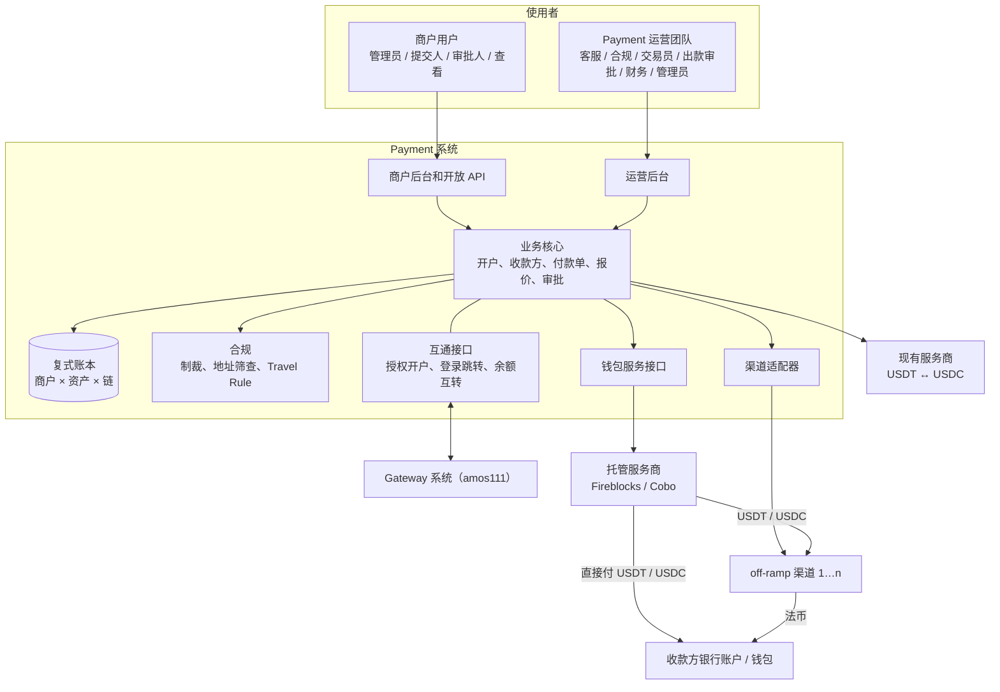
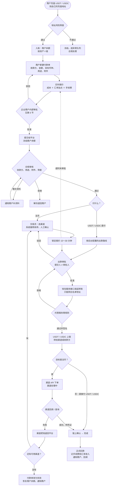
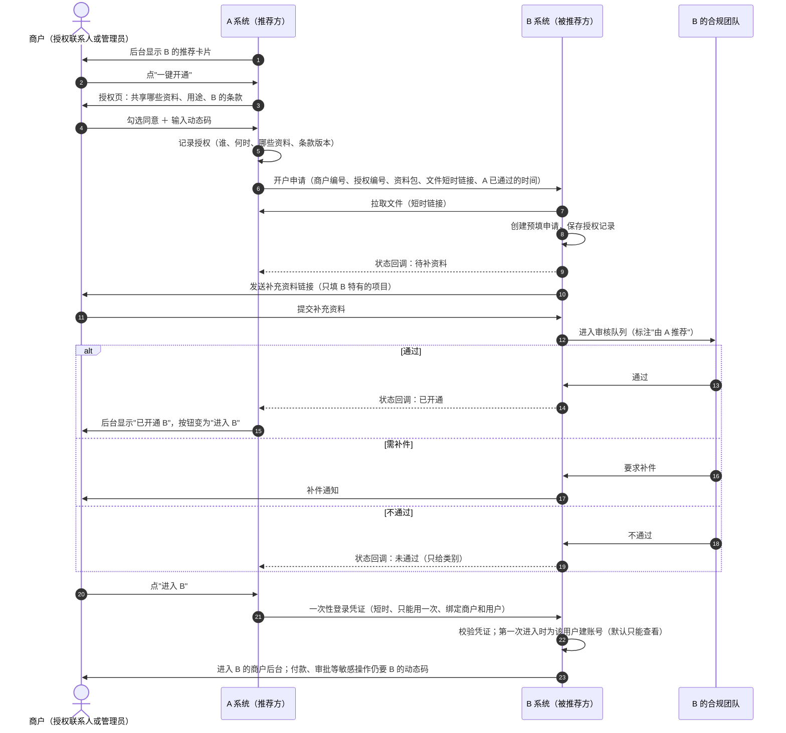
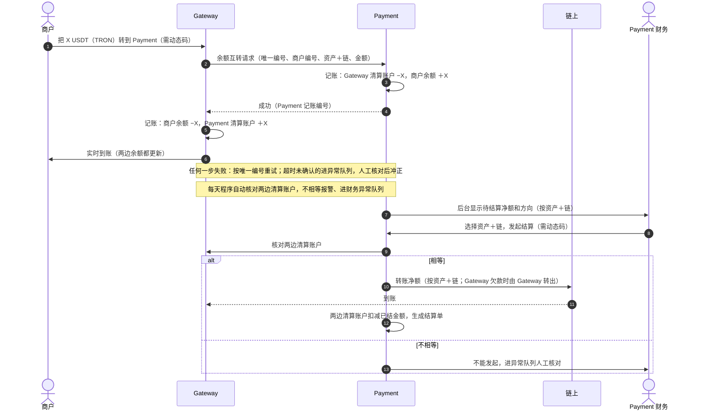
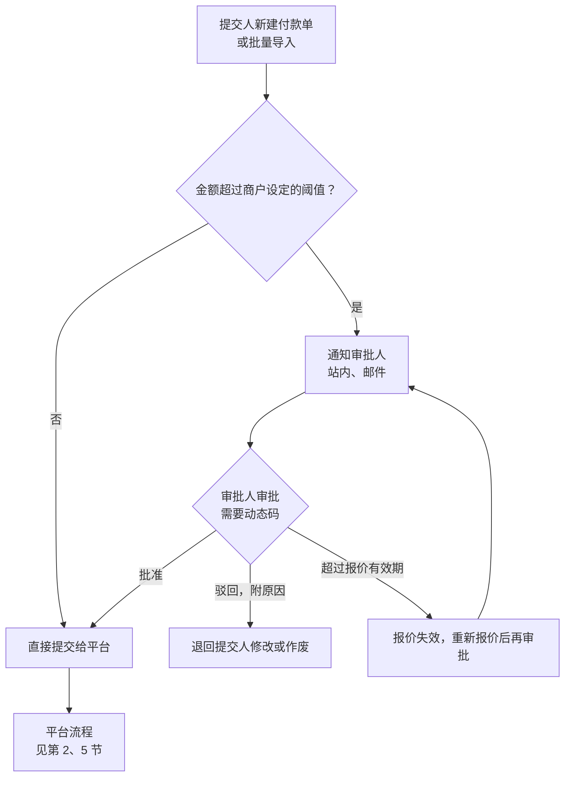
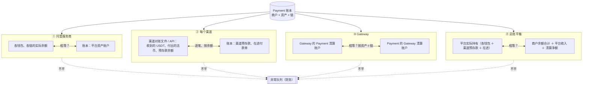
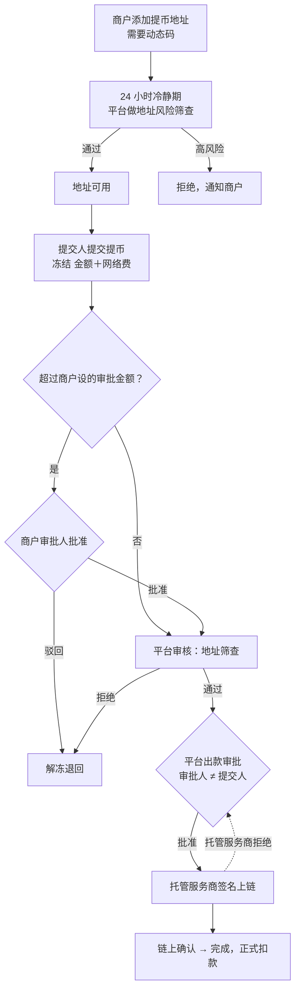

# 《流程图》v1：Payment（代付）系统
- 版本：v1.2
- 产出角色：PM（业务流程）、研发（系统交互）
- 状态：Amos 已答复 4 个问题（2026-10-23），按答复修改；开始做原型。团队确认随原型一起
- 输入：《系统架构方案 v1》（`技术方案/v1-架构方案.md`，Amos 2026-10-23 确认）
- 依据 agents main `bd492c9`
- 变更历史：v1（2026-10-23）首次创建；v1.1（2026-10-23）按 Amos 答复修改第 2、4、5 节；v1.2（2026-10-26）新增第 8 节提币

**目录**：[1 总体架构](#1-总体架构) · [2 付款主流程](#2-付款主流程) · [3 一键授权开户](#3-一键授权开户) · [4 余额互转和清算](#4-余额互转和清算) · [5 平台审批流和异常队列](#5-平台审批流和异常队列) · [6 企业商户内部审批](#6-企业商户内部审批) · [7 对账](#7-对账)

---

## 1. 总体架构
谁和谁打交道：两套系统通过服务接口互通；Payment 通过钱包服务接口使用托管服务商，通过渠道适配器使用 off-ramp 渠道。

---

## 2. 付款主流程
从商户充值到收款方收到钱。虚线是失败和退回的路径。

---

## 3. 一键授权开户
A 是推荐方，B 是被推荐的系统；Gateway → Payment、Payment → Gateway 都按这张图。

---

## 4. 余额互转和清算
商户在 Gateway 收到的钱转到 Payment 付款（反方向同理）。两边各自记账、各自对平；链上结算由财务在后台主动发起，不设固定时间和起付金额。

---

## 5. 平台审批流和异常队列
平台各角色怎么接力处理一笔付款单；异常统一进一个队列。

```mermaid
flowchart LR
    subgraph IN["进入平台"]
        S1[商户提交的付款单]
    end
    subgraph COMP["合规审核"]
        C1{收款方第一次使用？}
        C2[收款方尽调<br/>企业：资料；个人：户名＝KYC 姓名]
        C3[付款单审核<br/>用途、附件、制裁和地址筛查]
    end
    subgraph TRADE["交易员"]
        T1[法币付款单：询价、选渠道<br/>系统推荐排序]
        T2[锁定报价<br/>需要时 USDT ↔ USDC 兑换]
    end
    subgraph APPR["出款审批"]
        A1{审批人 ≠ 提交人}
        A2[批准 → 钱包服务接口出款]
    end
    subgraph FIN["财务"]
        F1[渠道预存款调拨]
        F2[对账]
        F3[发起 Gateway 清算]
    end
    EQ[["异常队列<br/>渠道退回、超时、筛查报警、对账差异<br/>每项有处理时限，超时提醒"]]

    S1 --> C1
    C1 -->|是| C2 --> C3
    C1 -->|否| C3
    C3 -->|通过，法币| T1 --> T2 --> A1
    C3 -->|通过，USDT / USDC 直付| A1
    A1 -->|批准| A2
    A1 -->|驳回| T1
    A2 --> F2
    A2 -.->|渠道失败，退回平台| T1
    T1 -.->|渠道预存款不足| F1 -.-> T1
    C3 -.->|报警| EQ
    A2 -.->|托管服务商拒绝 / 全部渠道失败| EQ
    F2 -.->|差异| EQ
    EQ -.->|处理后回到对应环节| C3
```

---

## 6. 企业商户内部审批
企业商户的财务提交、负责人审批；超过商户管理员自己设定的金额才需要审批；平台不设下限，设为 0 就是每笔都审批。

---

## 7. 对账
每天和三类对象对账：渠道、托管服务商、Gateway。任何一项不平都进异常队列。

---

## 8. 提币
商户把多余的钱提到自己的钱包。同时开通 Gateway 的商户还可以选择"和 Gateway 互转"（第 4 节）。

## Amos 的答复（2026-10-23）
1. 直接付 USDT、USDC 不需要交易员选渠道，出款路线在平台后台设置（第 2、5 节）。
2. 渠道付款失败：渠道把钱退回平台，平台换渠道再试；所有渠道都失败时，付款单改为失败，恢复商户余额（第 2 节）。
3. 和 Gateway 的链上结算由财务在后台主动发起和操作，后台显示待结算金额即可；不设固定时间和起付金额（第 4 节）。
4. 商户内部审批的金额由商户自己设，平台不设下限（第 6 节）。
