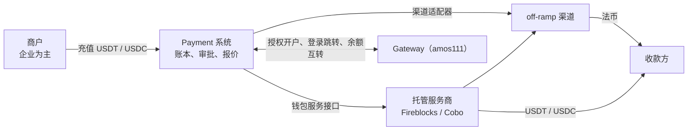

# 项目地图：amospayment（Payment 代付系统）
- 用途：**新加入的人或大模型先读这一份**，10 分钟了解项目现在是什么样、代码在哪里、有哪些不能破坏的约定。要查具体的文件、接口、表、变量、历史问题，看《[项目索引](项目索引.md)》。
- 只写**当前状态**。按版本追加的文档（架构方案、技术方案）是当时的记录；和本文件不一致时，以本文件和代码为准。
- 版本：v0（2026-10-23，对应代码：还没有代码，只有方案、流程图和项目概览）
- 维护：研发整合，各角色写自己的部分（C53）。**每次功能迭代，在同一个 PR 里更新本文件和《项目索引》**；`scripts/check-project-index.mjs` 在 CI 里检查索引（C54）。
- 变更历史：v0（2026-10-23）首次创建

## 一图看懂
完整的 7 张流程图见《[流程图 v1](技术方案/v1-流程图.md)》，给团队介绍用的图形化概览见 `项目概览.html`。

## 1. 这个项目做什么
帮商户付款给合作伙伴、渠道和其他需要付款的对象：商户把 USDT / USDC 充值进来，平台按场景匹配 off-ramp 渠道，付成多种法币或直接付 USDT / USDC。和 Gateway（收款）是两套系统、两个运营团队，通过接口互相推荐、一键授权开户、余额互转。

| 业务 | 版本 | 使用者 | 页面 | 接口 | 数据 |
|---|---|---|---|---|---|
| 代付（方案阶段） | v1 方案已确认 | 商户（提交人、审批人）、运营团队六种角色 | 待原型 | 待设计 | 待设计 |

一笔钱怎么走：商户充值 → 入账（按资产＋链）→ 新建付款单、报价 → 商户内部审批 → 平台合规审核 → 交易员选渠道、锁定报价 → 出款审批（提交人 ≠ 审批人）→ 托管服务商规则 → 上链 → 渠道付法币 → 完成、扣款记收入。

## 2. 代码怎么分层
还没有代码。规划的模块见《[架构方案 v1](技术方案/v1-架构方案.md)》第 3 节；部署平台待定（架构方案第 9 节）。

## 3. 环境
还没有环境。按 agents 规则：开发分支 → PR 到 `staging` → CI 绿 → Amos 在测试环境验收 → PR 到 `main` 上生产。`main`、`staging` 分支待 Amos 同意后创建。

| 环境 | 分支 | 地址 | 数据 | 外部服务 |
|---|---|---|---|---|
| 测试 | `staging`（待创建） | 待定 | 待定 | 托管服务商测试环境、渠道沙箱 |
| 生产 | `main`（待创建） | 待定 | 待定 | 待定 |

## 4. 关键流程在哪里
还没有代码。业务流程见《[流程图 v1](技术方案/v1-流程图.md)》。

## 5. 不能破坏的约定
1. 系统不保存私钥；所有出款通过钱包服务接口交给托管服务商签名，只能转白名单地址（架构方案第 7 节）。
2. 每笔出款都要"提交人 ≠ 审批人"，托管服务商的规则是第二道防线（架构方案第 8 节）。
3. 余额按"商户 × 资产 × 链"记，复式记账；跨链费用单独算（架构方案第 2、5 节）。
4. 和 Gateway 的余额互转实时记账、每日按净额链上结算，按唯一编号幂等（流程图第 4 节）。
5. 敏感操作在哪个系统做，就要那个系统自己的动态码；登录跳转凭证一次性、短时（流程图第 3 节）。

## 6. 常用命令
| 做什么 | 命令 |
|---|---|
| 项目地图和索引检查 | `node scripts/check-project-index.mjs` |
| 其他 | 开始开发后补充 |

## 7. 排查从哪里开始
还没有线上系统。现在的问题先看《项目索引》第 8 节和 PR 的 CI 结果。

## 8. 常见改动的检查清单
| 改动 | 要改的地方 |
|---|---|
| 新增文档 | 在《项目索引》第 9 节加一行；`node scripts/check-project-index.mjs` 通过 |

## 9. 冷启动问题清单
1. 一笔付款从商户提交到收款方收到，经过哪些角色和审批？
2. 商户从 Gateway 把余额转到 Payment，两边怎么记账、什么时候链上结算？
3. 系统在哪里签名出款？私钥在哪里？
4. 一个 PR 合并前要通过哪些自动检查？没通过时去哪里看原因？
